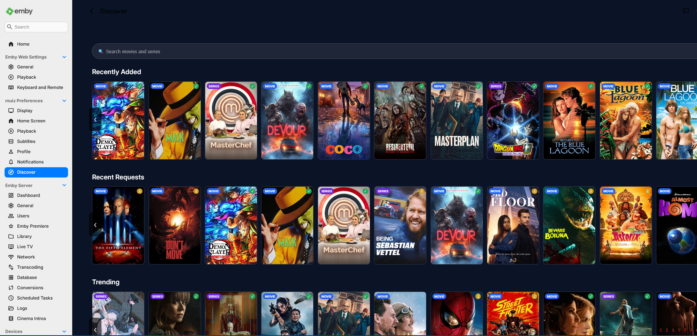
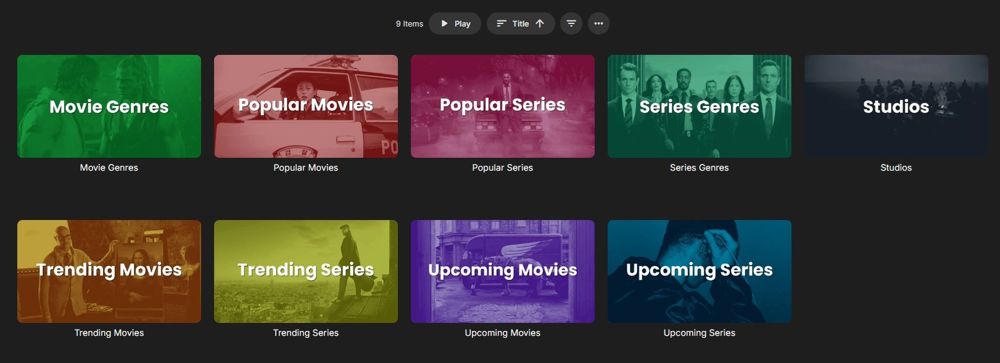
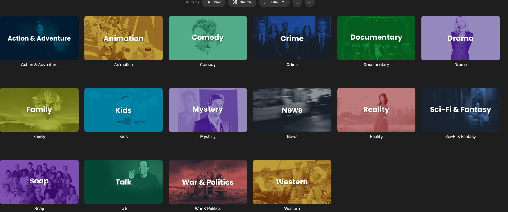
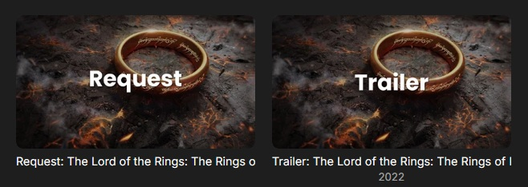
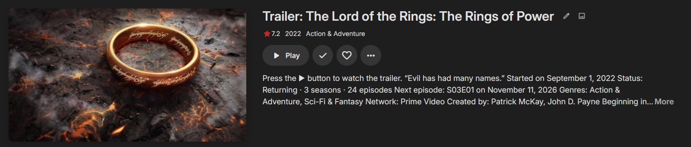
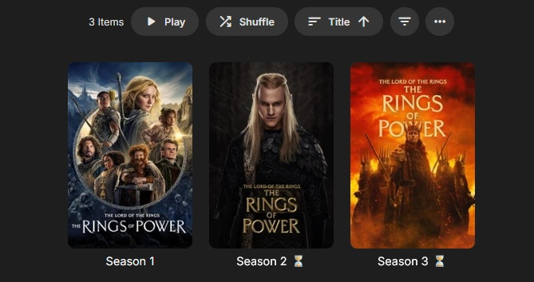
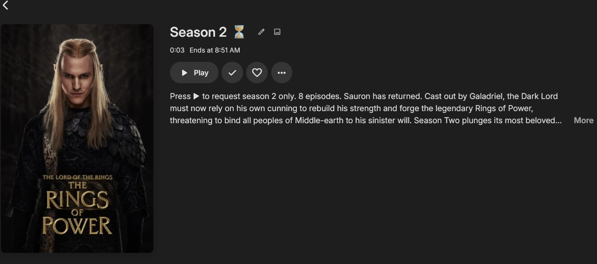

<p align="center">
  
</p>

<h1 align="center">Emby Discover</h1>

<p align="center">
  Browse movies and series from TMDB in Emby, watch trailers, and send requests to Radarr or Sonarr.
</p>

> **Status: stable.** The current version is **1.1.3**, built against the Emby SDK package `MediaBrowser.Server.Core` 4.10.0.1-beta so that one dll runs on both Emby Server 4.10.2 and 4.11 (beta). It has been installed on both; other Emby versions may work but have not been individually tested. Please report problems through [Issues](../../issues) and include the relevant diagnostics (see [Troubleshooting](#troubleshooting)).

## Screenshots

**Discover home** — recently added titles, recent requests and recommendations.

<p align="center">
  
</p>

**Discover Media channel** — browse the available lists and collections. Every folder has its own tile in the Seerr style.

<p align="center">
  
</p>

**Series genres** — open a genre to browse matching titles. Movie genres, studios and networks work the same way.

<p align="center">
  
</p>

**Request and Trailer** — every title has a Request tile and a Trailer tile, labelled on the image.

<p align="center">
  
</p>

<p align="center">
  
</p>

**Seasons** — for series you choose which season to request; seasons that are already in Sonarr are marked.

<p align="center">
  
</p>

<p align="center">
  
</p>

## What it does

- Adds a **Discover Media** channel with trending, popular and upcoming movies and series, genre lists, studios and networks.
- Provides a **Discover** page in the Emby web client with browsing and search.
- Lets users request movies through Radarr and series through Sonarr.
- Shows a trailer and a separate **Request** button on supported web-client detail pages. On series, the button opens a season picker. In the channel's browser view, a matched duplicate Request tile is hidden and its Trailer tile is renamed **Request**; native apps keep the original Trailer and Request items.
- Provides a Play-based request flow for Android, TV and other clients that cannot run the web button script.
- Shows whether a title is already requested or available when that status can be matched in Radarr or Sonarr. Season items say whether the season is already requested, partially available or in your library; requesting again is still possible.
- The Request and Trailer tiles carry the text "Request" and "Trailer" on their image so they are easy to tell apart.
- Follows the plugin language (Dutch, English or German) in the channel, on the Discover page and in the status and diagnostics pages.

## Requirements

- Emby Server 4.10.2 or newer (4.11 beta included). The plugin is built against `MediaBrowser.Server.Core` 4.10.0.1-beta; it has been installed on Emby Server 4.10.2.0 and on the 4.11 beta.
- A [TMDB API key](https://www.themoviedb.org/settings/api).
- Radarr for movie requests and/or Sonarr for series requests. Series requests require Sonarr v4 or v5 (tested with both; older versions are not supported).
- Emby's bundled `ffmpeg` is used to create some channel artwork and the request confirmation clip.

## Install

1. Download `Emby.Plugins.Discover.dll` from the [latest release](../../releases/latest).
2. Stop Emby, then copy the DLL into the Emby data directory's `plugins` folder. For Docker installations, this is usually `<Emby config folder>/plugins` (inside the container: `/config/plugins`).
3. Remove older **DLL files only** from that folder so only one version remains. Do not remove Discover's saved plugin settings; Emby stores them separately and the plugin ID stays the same between DLL versions.
4. Start Emby.
5. Open **Dashboard > Plugins > Discover**, configure the TMDB key and Radarr/Sonarr connection details, test the connections, select the quality profile and root folder, and save.
6. Give the intended users access to channels in their Emby user settings.
7. **For the first channel load, run the Internet Channels refresh once:** open **Dashboard > Scheduled Tasks > Internet Channels** and start **Refresh Internet Channels**. The initial refresh can take several minutes or longer. Leave it running until it finishes; be patient and do not repeatedly start the task.

The request-button script is embedded in the plugin DLL and is loaded by the browser when **Discover** is opened. The plugin does **not** edit `index.html` or other Emby web-client files, require write access to Emby's installation folders, or install a separate JavaScript file. After a browser hard refresh (`Ctrl+F5`), open **Discover** again to load the button script in that browser. Native Emby apps do not run browser scripts and use the Play-based request flow in the **Discover Media** channel.

For Docker, do not use `localhost` for Radarr or Sonarr unless those services share the Emby container's network namespace. Use an address that Emby can reach, such as a service/container name on the same Docker network or the host's LAN address.

## Use

- Open **Discover Media** and browse a list, genre, studio or network.
- In the web client, open a title's **Request** tile (shown as **Trailer** on its detail page) and choose **Request** to select seasons. No seasons are selected by default. The Trailer action uses Emby's player. If both matching tiles cannot be verified in that list, the browser leaves both unchanged.
- In native TV/Android apps, open the **Request** folder for a series and choose the **Season N** item; its **Play** action requests only that season.
- In the web client, season tiles show the short **Season N** label and are ordered numerically, independently of their status icons.
- In the channel browser view, the combined **Request** tile opens a detail page with **Trailer** playback and the **Request** button.
- Open folders and tiles to browse them; do not press Play on a folder.

The request confirmation clip shows a large poster with the status (Requested / Already in Radarr or Sonarr) and what was requested (Movie, Series, or Season N), so it stays readable on a TV or phone. For a season, the season's poster is used.

## Configuration

| Setting | Purpose |
|---|---|
| TMDB API key | Provides titles, artwork and metadata. |
| Plugin language | Defaults to following Emby's server UI language; Dutch, English and German can also be selected manually. |
| TMDB language | Defaults to following Emby's server UI language (`nl-NL` for Dutch and `en-US` otherwise); a TMDB language can also be selected manually. |
| Radarr URL and API key | Sends movie requests to Radarr. |
| Sonarr URL and API key | Sends series requests to Sonarr. |
| Quality profile and root folder | Selects the destination settings used for requests. Choose values returned by **Test connection**. |
| Show Diagnostics | Optional yellow debug message and technical media information on item pages. **Off by default.** |
| Show the Trailer tile | Shows the "Trailer: title" tile next to "Request" in the channel. **On by default.** Turn it off to keep only the request tile. |

API keys are stored in the plugin configuration and masked in the settings form by default.

## Troubleshooting

Open **Dashboard > Plugins > Discover > Status and diagnostics**. It reports the plugin and Emby versions, service connectivity, channel visibility, request counts and recent plugin events. Do not post API keys or other secrets in an issue.

For the first channel refresh, run **Refresh Internet Channels** from **Dashboard > Scheduled Tasks > Internet Channels** and wait for it to complete. The initial run may take several minutes or longer; avoid starting duplicate refreshes while it is still running.

For web-client button problems:

1. Open **Discover** in that browser to load the embedded button script. After installing or updating the plugin, hard-refresh (`Ctrl+F5`) and then open **Discover** again.
2. Enable **Show Diagnostics** in the plugin settings if you want the yellow item-page diagnostic. It is off by default.
3. Confirm that only one Discover DLL is installed and that Emby was restarted after replacing it.
4. If the script is still inactive, open the browser developer console, copy the relevant error, and include it with the diagnostics report. Android/TV apps do not support the browser button; use the channel's Request item and press Play instead.

Other common causes:

- The user cannot see the channel: grant channel access in that user's Emby settings.
- Radarr or Sonarr cannot be reached from Emby: verify the URL from the server/container, not just from a desktop browser.
- Old channel artwork or entries remain cached: run **Refresh Internet Channels** and wait for completion; Emby may retain channel items between requests.

## Build

Use the source ZIP attached to the same release to build that exact version:

```bash
dotnet build EmbyDiscover/EmbyDiscover.csproj -c Release
```

The output DLL is `EmbyDiscover/bin/Release/netstandard2.0/Emby.Plugins.Discover.dll`.


## Contributing


Issues and pull requests are welcome. Include the Emby Server version, client type, steps to reproduce, and relevant diagnostics.


## License


MIT. The embedded Poppins font is licensed under the SIL Open Font License; see THIRD-PARTY-NOTICES.md.


This product uses the TMDB API but is not endorsed or certified by TMDB. It is not affiliated with Emby, Radarr or Sonarr.
