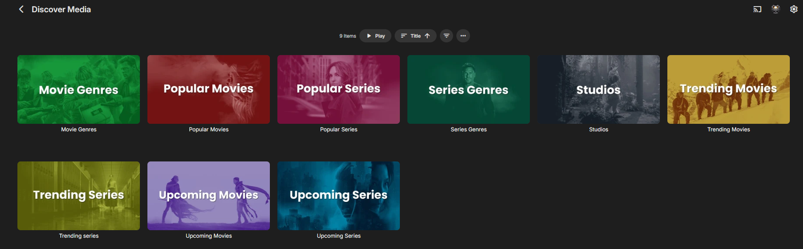
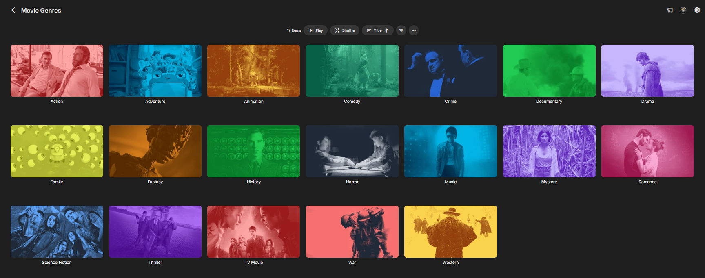

<p align="center">
  
</p>

<h1 align="center">Emby Discover</h1>

<p align="center">
  Browse movies and series from TMDB in Emby, watch trailers, and send requests to Radarr or Sonarr.
</p>

> **Status: beta.** The latest release is **1.0.35 beta**. It has been tested with Emby Server 4.11.0.9.
> Other Emby versions may work, but are not individually tested. Please report problems through
> [Issues](../../issues) and include the relevant diagnostics (see [Troubleshooting](#troubleshooting)).

## Screenshots

**Discover home** — recently added titles, recent requests and recommendations.

<p align="center">
  
</p>

**Discover Media channel** — browse the available lists and collections.

<p align="center">
  
</p>

**Movie genres** — open a genre to browse matching titles.

<p align="center">
  
</p>

## What it does

- Adds a **Discover Media** channel with trending, popular and upcoming movies and series, genre lists, studios and networks.
- Provides a **Discover** page in the Emby web client with browsing and search.
- Lets users request movies through Radarr and series through Sonarr.
- Shows a trailer and a separate **Request** button on supported web-client detail pages, including both Request and Trailer items.
- Provides a Play-based request flow for TV and other clients that cannot run the web button script.
- Shows whether a title is already requested or available when that status can be matched in Radarr or Sonarr.

## Requirements

- Emby Server. The plugin is built against `MediaBrowser.Server.Core` 4.9.1.90; the latest release was tested on 4.11.0.9.
- A [TMDB API key](https://www.themoviedb.org/settings/api).
- Radarr for movie requests and/or Sonarr for series requests.
- Emby's bundled `ffmpeg` is used to create some channel artwork and the request confirmation clip.

## Install

1. Download `Emby.Plugins.Discover.dll` from the [latest release](../../releases/latest).
2. Stop Emby, then copy the DLL into the Emby data directory's `plugins` folder. For Docker installations, this is usually `<Emby config folder>/plugins` (inside the container: `/config/plugins`).
3. Remove older copies of the Discover DLL from that folder so only one version remains.
4. Start Emby.
5. Open **Dashboard > Plugins > Discover** and configure the TMDB key and the Radarr/Sonarr connection details. Use **Test connection**, select the quality profile and root folder, and save.
6. Give the intended users access to channels in their Emby user settings.
7. Open **Discover** once in the Emby web client. This activates the web-client request buttons for that browser.

The button script is embedded in the plugin DLL and is served by Emby. A normal installation does **not** require editing `index.html`, changing permissions on Emby's web-client folder, or installing a separate JavaScript file. If you have an old manual script include from a previous installation, remove it only after confirming the current plugin works.

For Docker, do not use `localhost` for Radarr or Sonarr unless those services share the Emby container's network namespace. Use an address that Emby can reach, such as a service/container name on the same Docker network or the host's LAN address.

## Use

- Open **Discover Media** and browse a list, genre, studio or network.
- In the web client, open a title and choose **Request**. On a series, choose the seasons to monitor when prompted.
- To watch a trailer, open its **Trailer** item and press **Play**.
- In TV apps or other clients without the web request button, open the title's **Request** item and press **Play** to send the request. The short confirmation clip is used by this fallback flow; do not remove it if those clients are in use.
- Open folders and tiles to browse them; do not press Play on a folder.

## Configuration

| Setting | Purpose |
|---|---|
| TMDB API key and language | Provides titles, artwork and metadata. |
| Radarr URL and API key | Sends movie requests to Radarr. |
| Sonarr URL and API key | Sends series requests to Sonarr. |
| Quality profile and root folder | Selects the destination settings used for requests. Choose values returned by **Test connection**. |
| Show Diagnostics | Keeps the browser diagnostic line and technical media information visible when enabled. |

API keys are stored in the plugin configuration and are masked in the settings form by default.

## Troubleshooting

Open **Dashboard > Plugins > Discover > Status and diagnostics**. It reports the plugin and Emby versions, service connectivity, channel visibility, request counts and recent plugin events. Do not post API keys or other secrets in an issue.

For web-client button problems:

1. Open **Discover** once in that browser, then refresh the page. Try a hard refresh (`Ctrl+F5`) after an update.
2. On the Discover page, check that diagnostics say **button script active in browser: YES** and show the expected plugin version.
3. Confirm that only one Discover DLL is installed and that Emby was restarted after replacing it.
4. If the script is still inactive, open the browser developer console, copy the relevant error, and include it with the diagnostics report.

Other common causes:

- The user cannot see the channel: grant channel access in that user's Emby settings.
- Radarr or Sonarr cannot be reached from Emby: verify the URL from the server/container, not just from a desktop browser.
- Old channel artwork or entries remain cached: restart Emby and reopen the channel; Emby may retain channel items between requests.

## Build

Use the source ZIP attached to the same release to build that exact version:

```bash
dotnet build EmbyDiscover/EmbyDiscover.csproj -c Release
```

The output DLL is `EmbyDiscover/bin/Release/netstandard2.0/Emby.Plugins.Discover.dll`.

## Contributing

Issues and pull requests are welcome. Include the Emby Server version, client type, steps to reproduce, and relevant diagnostics.

## License

[MIT](LICENSE). The embedded Poppins font is licensed under the SIL Open Font License; see
[THIRD-PARTY-NOTICES.md](THIRD-PARTY-NOTICES.md).

This product uses the TMDB API but is not endorsed or certified by TMDB. It is not affiliated with Emby, Radarr or Sonarr.
