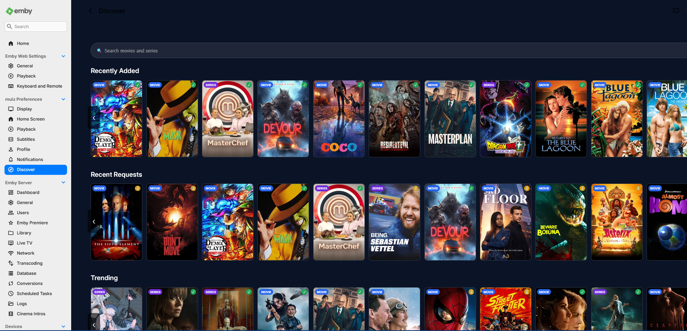
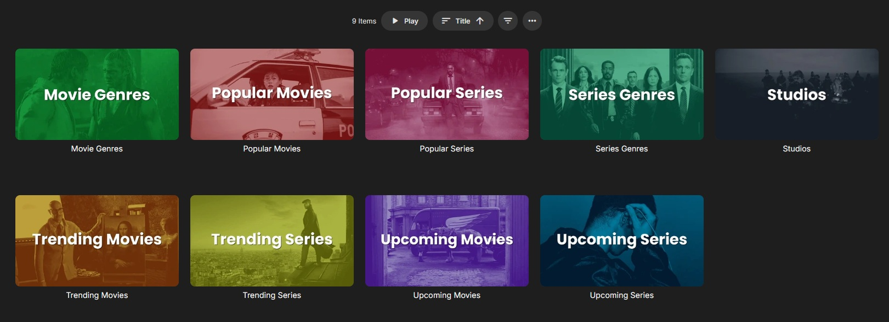
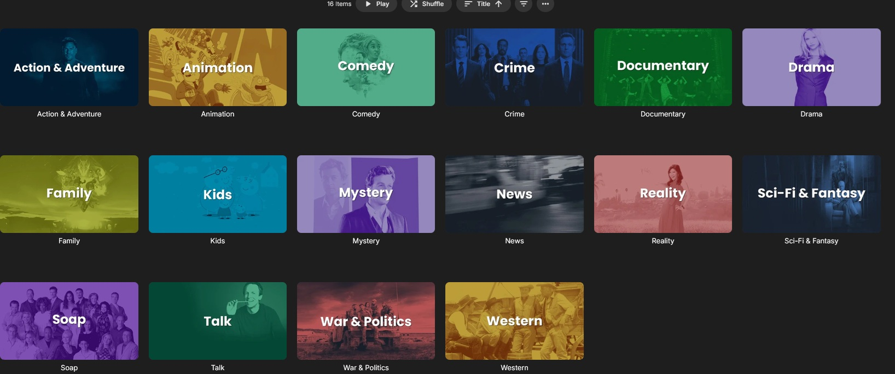
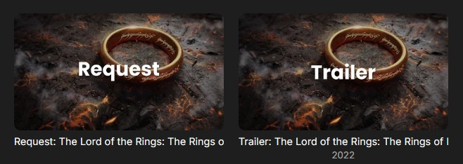
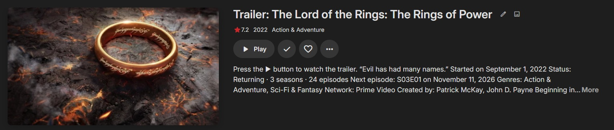
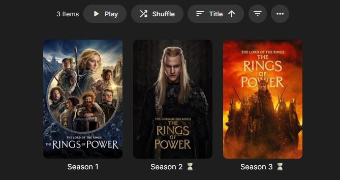
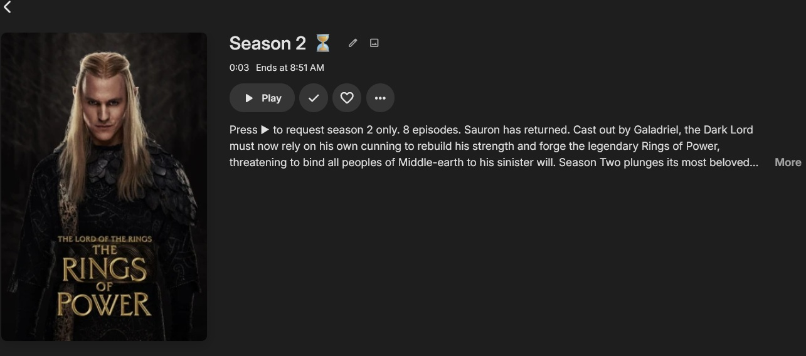
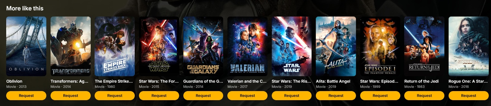
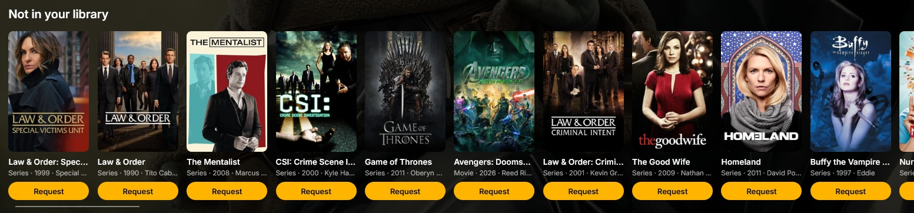
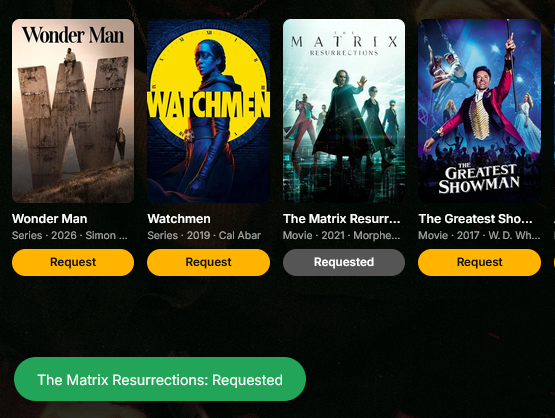

<p align="center">
  
</p>

<h1 align="center">Emby Discover</h1>

<p align="center">
  Browse movies and series from TMDB in Emby, watch trailers, and send requests to Radarr or Sonarr.
</p>

<p align="center">
  <a href="https://ko-fi.com/mrmuiz"></a>
</p>

> **New: [Discover Enabler](https://github.com/mrmuiz/Enabler-for-Emby)** brings the full Discover page to the **Emby for Android** app (phones, tablets, Android TV boxes and Fire TV). See [Emby for Android: Discover Enabler](#emby-for-android-discover-enabler).

> **Status: stable.** The current version is **1.4.0.7**, built against the Emby SDK package `MediaBrowser.Server.Core` 4.10.0.1-beta so that one dll runs on both Emby Server 4.10.2 and 4.11 (beta). It has been installed on both; other Emby versions may work but have not been individually tested. Please report problems through [Issues](../../issues) and include the relevant diagnostics (see [Troubleshooting](#troubleshooting)).

## Screenshots

**Discover home** — recently added titles, recent requests and recommendations.

<p align="center">
  
</p>

**Discover Media channel** — browse the available lists and collections. Every folder has its own tile in the Seerr style.

<p align="center">
  
</p>

**Series genres** — open a genre to browse matching titles. Movie genres, studios and networks work the same way.

<p align="center">
  
</p>

**Request and Trailer** — every title has a Request tile and a Trailer tile, labelled on the image.

<p align="center">
  
</p>

<p align="center">
  
</p>

**Seasons** — for series you choose which season to request; seasons that are already in Sonarr are marked.

<p align="center">
  
</p>

<p align="center">
  
</p>

**More like this** — on movie and series pages, TMDB recommendations you don't have yet, each with a Request button. The same layout is used for the collection row on movie pages.

<p align="center">
  
</p>

**Not in your library** — on actor and director pages, their other movies and series from TMDB. Series open the season picker.

<p align="center">
  
</p>

**Requesting from a row** — the button turns into the status (Requested / Available) and a confirmation appears. Click a poster to open that title in the Discover popup with its info and trailer.

<p align="center">
  
</p>

## What it does

- Adds a **Discover Media** channel with trending, popular and upcoming movies and series, genre lists, studios and networks.
- Provides a **Discover** page in the Emby web client with browsing and search.
- Lets users request movies through Radarr and series through Sonarr.
- Shows a trailer and a separate **Request** button on supported web-client detail pages. On series, the button opens a season picker. In the channel's browser view, a matched duplicate Request tile is hidden and its Trailer tile is renamed **Request**; native apps keep the original Trailer and Request items.
- Adds a **Not in your library** section to actor and director pages in the web client, listing their other movies and series from TMDB with a Request button.
- Adds a **Collection** row to movie pages in the web client: the other movies from the same TMDB collection that are not in your library, with a Request button.
- Adds a **More like this** row to movie and series pages in the web client: TMDB recommendations that are not in your library, with a Request button (series open the season picker). Clicking a poster in these rows opens that title in the Discover popup with its info and trailer.
- Provides a Play-based request flow for Android, TV and other clients that cannot run the web button script.
- Shows whether a title is already requested or available when that status can be matched in Radarr or Sonarr (or Seerr). Season items say whether the season is already requested, partially available or in your library; requesting again is still possible.
- The Request and Trailer tiles carry the text "Request" and "Trailer" on their image so they are easy to tell apart.
- Follows the plugin language (English, Dutch, German or Norwegian) in the channel, on the Discover page and in the status and diagnostics pages.

### Discover page and popup (web client)

- Rows at the top: **Recently added**, **Recent requests**, **My requests** and **New seasons** (series in your library with a later season on TMDB), plus optional **Trakt watchlist** and **TMDB list** rows with **Request all**. Every row can be switched on or off; short rows use wide cards with download progress.
- **Genre and sort** in Popular movies and Popular series (popular within a genre, newest, top rated), and filters in the grids (year, score, language, not in my library).
- **Movies / Series choice** on studio and streaming-service pages (Netflix, Disney+, Prime Video, Apple TV+, Hulu, HBO/Max, discovery+). For a streaming service, *Movies* shows what you can watch there with a subscription in your country.
- Studio and network tiles show the **logo in its own colours** when TMDB has a version that is visible on the dark tile.
- The popup shows the **title logo** (from Emby, TMDB or optionally fanart.tv), trailer, cast with photos (person page with biography and their other movies and series) and an **info table**: original title, status, release dates (cinema / digital / physical), runtime, revenue, budget, language, countries, director or creator, studios or networks and, for running series, the **next episode** (TVmaze). Scores at the top (TMDB, and with a free **MDBList** key also IMDb, Rotten Tomatoes critics and audience, Metacritic, Letterboxd and Trakt; OMDb as fallback), links to Emby, TMDB, IMDb, Trakt, Letterboxd, Rotten Tomatoes and TVmaze at the bottom.
- For movies that are part of a series, the popup shows the whole **collection**: request single films with the **+** on a poster or all films at once (with a warning and a confirmation step).
- While a title downloads, the popup shows a live **progress bar**, including SABnzbd's steps after downloading (verifying, repairing, extracting).
- On a wide screen and on a TV the popup uses two columns, so it fits without scrolling.
- **Theme colour** for buttons, focus and accents, and optional year and score under the posters.
- Works with a TV remote (arrow keys, including inside the popup) and with a pointer such as the LG Magic Remote.

### Requests and users

- **Request limit per user**: at most N requests per X days (administrators are exempt; in Seerr mode Seerr's own quotas apply).
- **Overview of all requests** for administrators, with a count per user.
- A **"… is available to watch"** notification in Emby for the person who requested a title, as soon as it has files.
- Announced seasons can already be requested; Sonarr picks them up when they appear.

## Which Emby apps get what

| | Web client (browser) | Emby for Android with [Discover Enabler](https://github.com/mrmuiz/Enabler-for-Emby) | Other Emby apps (LG, Samsung, Android TV app, iOS, ...) |
|---|---|---|---|
| **Discover Media** channel: browse, Request and Trailer tiles | Yes | Yes | Yes |
| Requesting through Radarr / Sonarr / Seerr | Yes | Yes | Yes (press Play on the Request item) |
| **Discover** page with search and popup | Yes | Yes | No |
| Request button, *More like this*, *Collection* and *Not in your library* on normal detail pages | Yes | Yes | No |
| Tile opens the Discover page directly (setting) | Yes | Yes | No |

The official Emby apps ship their own built-in client, which a plugin cannot extend. In those apps everything goes through the **Discover Media** channel, which works everywhere.

### Emby for Android: Discover Enabler

[**Discover Enabler**](https://github.com/mrmuiz/Enabler-for-Emby) is a small tool (Windows, Linux, macOS) that makes the official **Emby for Android** app load this plugin: Discover in the app's menu, the Discover tile opens the Discover page and the Request button works on Emby's own pages. It downloads the app straight from Emby for your device (phones and tablets, Android TV boxes, Fire TV) and changes nothing else; Emby Premiere stays as it is. The separate *Emby for Android TV* and *Fire TV* apps cannot be patched; on those devices use the patched ARMv7 or Fire TV build instead.

<p align="center">
  <a href="https://github.com/mrmuiz/Enabler-for-Emby"></a>
</p>

## Requirements

- Emby Server 4.10.2 or newer (4.11 beta included). The plugin is built against `MediaBrowser.Server.Core` 4.10.0.1-beta; it has been installed on Emby Server 4.10.2.0 and on the 4.11 beta.
- A [TMDB API key](https://www.themoviedb.org/settings/api).
- Radarr for movie requests and/or Sonarr for series requests, **or** a Seerr (Jellyseerr/Overseerr) server. Series requests through Sonarr require Sonarr v4 or v5 (tested with both; older versions are not supported).
- Optional: a free [MDBList API key](https://mdblist.com/preferences/) for IMDb, Rotten Tomatoes, Metacritic, Letterboxd and Trakt scores in the popup (or an [OMDb API key](https://www.omdbapi.com/apikey.aspx) for IMDb, Rotten Tomatoes and Metacritic).
- Optional: a [fanart.tv API key](https://fanart.tv/get-an-api-key/) for more title logos.
- Emby's bundled `ffmpeg` is used to create some channel artwork and the request confirmation clip.

## Install

1. Download `Emby.Plugins.Discover.dll` from the [latest release](../../releases/latest).
2. Stop Emby, then copy the DLL into the Emby data directory's `plugins` folder. For Docker installations, this is usually `<Emby config folder>/plugins` (inside the container: `/config/plugins`).
3. Remove older **DLL files only** from that folder so only one version remains. Do not remove Discover's saved plugin settings; Emby stores them separately and the plugin ID stays the same between DLL versions.
4. Start Emby.
5. Open **Dashboard > Plugins > Discover**, configure the TMDB key and Radarr/Sonarr connection details, test the connections, select the quality profile and root folder, and save.
6. Give the intended users access to channels in their Emby user settings.
7. **For the first channel load, run the Internet Channels refresh once:** open **Dashboard > Scheduled Tasks > Internet Channels** and start **Refresh Internet Channels**. The initial refresh can take several minutes or longer. Leave it running until it finishes; be patient and do not repeatedly start the task.

The plugin adds a small loader script to the web client's `index.html` (setting **Tile opens the Discover page**, on by default), so the Discover tile opens the Discover page and the Request button works on every detail page. If the web client folder is read-only (often in Docker), the loader cannot be added: the Discover page and buttons still work after **Discover** has been opened once in that browser; see [Docker: writable web client](#docker-writable-web-client). Native Emby apps do not run browser scripts and use the Play-based request flow in the **Discover Media** channel (except Emby for Android with [Discover Enabler](#emby-for-android-discover-enabler)).

For Docker, do not use `localhost` for Radarr or Sonarr unless those services share the Emby container's network namespace. Use an address that Emby can reach, such as a service/container name on the same Docker network or the host's LAN address.

## Use

- Open **Discover Media** and browse a list, genre, studio or network.
- In the web client, open a title's **Request** tile (shown as **Trailer** on its detail page) and choose **Request** to select seasons. No seasons are selected by default. The Trailer action uses Emby's player. If both matching tiles cannot be verified in that list, the browser leaves both unchanged.
- In native TV/Android apps, open the **Request** folder for a series and choose the **Season N** item; its **Play** action requests only that season.
- In the web client, season tiles show the short **Season N** label and are ordered numerically, independently of their status icons.
- In the channel browser view, the combined **Request** tile opens a detail page with **Trailer** playback and the **Request** button.
- Open folders and tiles to browse them; do not press Play on a folder.

The request confirmation clip shows a large poster with the status (Requested / Already in Radarr or Sonarr) and what was requested (Movie, Series, or Season N), so it stays readable on a TV or phone. For a season, the season's poster is used.

## Configuration

The settings are split over tabs: **General**, **Appearance**, **Sources**, **Requests** (Radarr/Sonarr or Seerr), **Users**, **Storage** and **Diagnostics**. The plugin finds the web client folder (with `index.html`) automatically; in the rare case it does not, the folder can be set as `DashboardUiPath` in the plugin's XML configuration file.

| Setting | Tab | Purpose |
|---|---|---|
| Plugin language | General | Defaults to following Emby's server UI language; English, Dutch, German and Norwegian can also be selected manually. |
| Tile opens the Discover page | Appearance | Web client only. A tap on the **Discover Media** tile opens the Discover page directly, and the Request button works on detail pages without opening Discover first. Adds a small loader to the web client's `index.html`, re-applied on every server start. It stays in place and reads this switch live, so turning it on or off works right after saving (off = the tile opens the channel tiles). **On by default.** |
| Show the Trailer tile | Appearance | Shows the "Trailer: title" tile next to "Request" in the channel. **On by default.** |
| Rows on the Discover page | Appearance | Switch **Recently added**, **Recent requests**, **My requests** and **New seasons** on or off. |
| TMDB list / Trakt watchlist | Appearance | Optional extra rows: a TMDB list (id or link) and a public Trakt watchlist (username + Client ID), each with a test button. |
| Theme colour | Appearance | Colour of buttons, focus and accents (yellow, Emby green, blue, turquoise, purple, pink, red, orange, white). |
| Year / score under posters | Appearance | Show or hide the year and the TMDB score under the posters. |
| Title logo / next episode | Appearance | Show the title logo instead of the title text, and the next episode of running series. **On by default.** |
| TMDB API key | Sources | Provides titles, artwork and metadata. |
| TMDB language | Sources | Defaults to following Emby's server UI language (`nl-NL` for Dutch and `en-US` otherwise); a TMDB language can also be selected manually. |
| Exclude languages | Sources | Hide titles by original language. |
| MDBList API key | Sources | Optional (free, 1000 requests a day). IMDb, Rotten Tomatoes (critics and audience), Metacritic, Letterboxd and Trakt scores in the popup, with a test button. Cached per title. |
| OMDb API key | Sources | Optional fallback for IMDb, Rotten Tomatoes and Metacritic scores. |
| fanart.tv API key | Sources | Optional. More title logos when Emby and TMDB have none. |
| Request through | Requests | Radarr/Sonarr directly, or a Seerr server (URL and API key). |
| Radarr / Sonarr URL and API key | Requests | Sends movie requests to Radarr and series requests to Sonarr. |
| SABnzbd URL and API key (optional) | Requests | Adds the download speed, the stages after 100% (verifying, repairing, extracting, moving, script) and SABnzbd's paused/speed-limit state to the download progress. |
| NZBGet, qBittorrent, Transmission URL, username and password (optional) | Requests | Same for these downloaders; torrents also show seeders and ratio. |
| Quality profile and root folder | Requests | Selects the destination settings used for requests. Choose values returned by **Test connection**. |
| Request limit | Users | At most N requests per X days per user (0 = no limit). Administrators are exempt. Also shows the overview of all requests. |
| Storage | Storage | How long confirmation clips and tile images are kept, and the maximum cache size. |
| Show Diagnostics | Diagnostics | Optional yellow debug message and technical media information on item pages. Off by default. |

API keys are stored in the plugin configuration and masked in the settings form by default.

## Troubleshooting

Open **Dashboard > Plugins > Discover > Status and diagnostics**. It reports the plugin and Emby versions, service connectivity, channel visibility, request counts and recent plugin events. Do not post API keys or other secrets in an issue.

For the first channel refresh, run **Refresh Internet Channels** from **Dashboard > Scheduled Tasks > Internet Channels** and wait for it to complete. The initial run may take several minutes or longer; avoid starting duplicate refreshes while it is still running.

For web-client button problems:

1. Open **Discover** in that browser to load the embedded button script. After installing or updating the plugin, hard-refresh (`Ctrl+F5`) and then open **Discover** again.
2. Enable **Show Diagnostics** in the plugin settings if you want the yellow item-page diagnostic. It is off by default.
3. Confirm that only one Discover DLL is installed and that Emby was restarted after replacing it.
4. If the script is still inactive, open the browser developer console, copy the relevant error, and include it with the diagnostics report. Android/TV apps do not support the browser button; use the channel's Request item and press Play instead.

Other common causes:

- The user cannot see the channel: grant channel access in that user's Emby settings.
- Radarr or Sonarr cannot be reached from Emby: verify the URL from the server/container, not just from a desktop browser.
- **Tile opens the Discover page** reports "Access denied" or "read-only" (Docker): see [Docker: writable web client](#docker-writable-web-client) below.
- Old channel artwork or entries remain cached: run **Refresh Internet Channels** and wait for completion; Emby may retain channel items between requests.

### Docker: writable web client

In Docker, `/system/dashboard-ui` is read-only for the Emby user, so the loader cannot be added. The Discover page and request buttons still work after opening **Discover** once; only the tile shortcut and the buttons before that are affected (browser only). Fix it with a writable bind mount:

1. Copy the web client out of the container (adjust names, paths, UID/GID):
   ```bash
   docker cp <container>:/system/dashboard-ui /path/to/config/dashboard-ui
   chown -R <UID>:<GID> /path/to/config/dashboard-ui
   ```
2. Add the bind mount to your compose file:
   ```yaml
   services:
     emby:
       volumes:
         - /path/to/config:/config
         - /path/to/config/dashboard-ui:/system/dashboard-ui:rw
   ```
3. Apply it with `docker compose up -d`.
4. Enable **Tile opens the Discover page** in the plugin settings. The diagnostics should now show `[ OK ]` for the tile.

Notes:

- Do step 1 before step 2. An empty bind mount breaks the web UI.
- `<UID>:<GID>` must match the `UID`/`GID` environment variables of your container.
- After an Emby update, refresh the folder from the new image, or the web client stays outdated.
- Alternative: copy the folder anywhere writable and set it as `DashboardUiPath` in the plugin's XML configuration file.

## Build

Use the source ZIP attached to the same release to build that exact version:

```bash
dotnet build EmbyDiscover/EmbyDiscover.csproj -c Release
```

The output DLL is `EmbyDiscover/bin/Release/netstandard2.0/Emby.Plugins.Discover.dll`.


## Contributing


Issues and pull requests are welcome. Include the Emby Server version, client type, steps to reproduce, and relevant diagnostics.


## License


MIT. The embedded Poppins font is licensed under the SIL Open Font License; see THIRD-PARTY-NOTICES.md.


This product uses the TMDB API but is not endorsed or certified by TMDB. It is not affiliated with Emby, Radarr or Sonarr.
